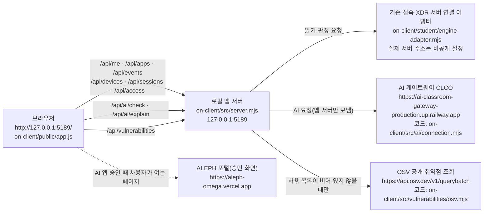

# 케셰브 학생 실행 설명서 (21단계)

이 문서는 학생이 새로 작성했습니다. 제공 문서(`on-client/README.md`, `on-client/docs/*`)는 고치지 않았습니다. 이 문서가 제공 문서와 다르면 실제 코드와 대조한 이 문서의 "확인 기록"을 먼저 봅니다.

- 작성일: 2026-11-01
- 대상 앱: 케셰브(보안 Agent 앱). 실행 폴더는 `on-client`입니다. 앱 버전은 `on-client/package.json`의 `version`입니다. 이 문서의 코드 읽기와 서버 실행은 커밋 `91086ba`의 `0.2.14` 기준이고, 내 PC 작업 폴더는 시작 틀 `0.2.21`로 갱신된 상태입니다(`git diff package.json`으로 확인, 아직 커밋하지 않은 변경). 두 버전의 차이는 6장에 적었습니다.
- 목적: 로그인한 직원이 자기 로그인 상태, 업무 앱 접속 판정, 최근 접속·보안 기록, AI 설명, 설치 패키지의 알려진 취약점을 한 화면에서 보는 앱입니다. 본인 범위만 보여 주며 회사 전체 관리자 화면이 아닙니다.
- 이 문서의 표기: **실제 확인**은 아래 6장 "확인 기록"에 적은 실행을 한 것입니다. **코드로만 읽음**은 코드를 읽었으나 실행하지 않은 것입니다. **미확인**은 읽지도 실행하지도 않은 것입니다. 표기가 없는 문장은 코드나 파일 이름만 설명합니다.

## 1. 필요한 프로그램과 버전

| 프로그램 | 요구 버전 | 확인한 버전 | 근거 |
|---|---|---|---|
| Node.js | 22~24 (수업 기준 24.19.0) | 수업용 AI 작업 환경(Linux): v22.23.4. 내 Windows PC: **v24.15.0** (실행 도구가 `참고: 지금 Node.js 는 v24.15.0 입니다. 수업 기준은 v24.19.0 입니다.`라고 알림. 22~24 범위라 실행은 막히지 않음) | 요구 버전은 `on-client/package.json`의 `engines`와 `on-client/tools/start-alekov.ps1`에서 읽음. 내 PC 값은 PowerShell에서 `node --version`으로 확인해 이 칸에 적습니다 |
| npm | Node.js에 포함 | 수업용 AI 작업 환경: 10.9.9 | `npm --version` |
| Windows PowerShell | 실행 도구(`start-alekov.ps1`)용 | 내 Windows PC의 Windows PowerShell에서 실행 도구가 켜짐(6-3). 버전 번호는 확인하지 않음 | |
| 브라우저 | 주소 `http://127.0.0.1:5189/`를 열 수 있는 것 | 수업용 AI 작업 환경의 Chromium(자동 조작)으로 화면을 열어 봄. 내 PC 브라우저: **확인 필요** | |

외부 npm 의존성은 없습니다(`on-client/package.json`에 `dependencies`가 없음). 그래서 `npm install`이 필요 없습니다.

## 2. 폴더 구조

Git 저장소의 최상위는 프로젝트 폴더 `choi-bujang-secret-vault`입니다. 앱은 그 안의 `on-client` 폴더입니다. 커밋과 제출은 프로젝트 폴더 기준이고, 앱 실행은 `on-client` 폴더 기준입니다.

```text
choi-bujang-secret-vault/          ← Git 최상위 (커밋·제출 기준)
├─ docs/STUDENT_RUNBOOK.md         ← 이 문서 (학생 작성)
├─ README.md                       ← 1~12단계 학생 기록 + 21단계 안내
└─ on-client/                      ← 케셰브 앱 폴더 (PowerShell을 여는 곳)
   ├─ package.json                 ← start / demo / check 명령
   ├─ tools/start-alekov.ps1       ← 실행 도구 (제공)
   ├─ src/server.mjs               ← 로컬 앱 서버 (제공)
   ├─ public/                      ← 브라우저 화면 index.html, app.js, style.css (제공)
   ├─ student/extension.mjs        ← 학생 구현 (renderIdentity ~ renderVulnerabilities)
   ├─ student/engine-adapter.mjs   ← 기존 서버 연결 어댑터 (제공, 수정 안 함)
   └─ docs/                        ← 제공 안내 문서
```

## 3. 실행·종료·재실행

### 3-1. 실행 (권장: 실행 도구)

1. 파일 탐색기에서 `on-client` 폴더를 엽니다.
2. 주소 표시줄에 `powershell`을 입력하고 Enter를 누릅니다. 그 폴더에서 PowerShell 창이 열립니다.
3. 아래 한 줄을 실행합니다.

```powershell
powershell -NoProfile -ExecutionPolicy Bypass -File .\tools\start-alekov.ps1
```

- 정상 시작 신호(내 PC에서 `0.2.21` 도구로 실제 확인, 6-3): 창에 `케셰브가 켜졌습니다. 브라우저에서 http://127.0.0.1:5189/ 을 여세요.`와 `서버가 응답한 것만 확인했습니다. AI 연결 상태는 화면에서 따로 확인해 주세요.`가 나옵니다. `0.2.21`에서는 그 앞에 `계정 연결 준비가 끝났습니다. 앱에서 확인 번호로 로그인·승인을 진행하세요.`와 `케셰브 연결 확인: http://127.0.0.1:5189`도 나오고, 끝에 `끄려면 이 창에서 Ctrl+C 를 누르세요.`가 나옵니다. 이 줄들은 서버가 응답했다는 뜻이며 AI 연결이 됐다는 뜻이 아닙니다.
- 실행 도구는 시작 전에 Node.js 버전, 폴더 구성, 포트 사용 여부를 확인합니다. 문제가 있으면 5장 표의 메시지가 나옵니다.

### 3-2. 실행 (대체: npm 명령)

같은 `on-client` 폴더의 PowerShell에서 실행합니다. 실행 도구를 쓸 수 없을 때의 대체 방법입니다.

| 목적 | 명령 | 정상 시작 신호 | 실제 확인 |
|---|---|---|---|
| 기본 실행(기존 서버 연결 없음) | `npm start` | `케셰브 연결 확인: http://127.0.0.1:5189` | `node src/server.mjs`로 포트 5190에서 같은 줄을 확인함(6장) |
| 예제 자료로 실행 | `npm run demo` | `케셰브 예제: http://127.0.0.1:5189` | `node src/server.mjs --demo`로 같은 줄을 확인함(6장) |
| 문법만 확인 | `npm run check` | 오류 없이 끝남(종료 코드 0) | 확인함(6장). 앱 화면이나 연결을 확인하는 명령이 아닙니다 |

### 3-3. 브라우저 주소

`http://127.0.0.1:5189/` 입니다. 이 주소는 내 PC 안에서만 열립니다. 포트를 바꿨다면(`-Port 5190`) 주소의 숫자도 바꿉니다.

화면 위쪽 표시로 지금 실행 방식을 구분합니다.

| 위쪽 표시 | 뜻 | 실제 연결인가 |
|---|---|---|
| `예제 데이터(demo) · 실제 연결 아님` | 예제 자료 | 아니요 |
| `연결 없음` | 기존 서버 연결이 켜지지 않은 기본 실행 | 아니요(정상 시작 상태) |

### 3-4. 종료와 재실행

- 종료: 앱을 실행한 PowerShell 창에서 `Ctrl+C`를 누릅니다. 브라우저에서 주소가 더 이상 열리지 않으면 종료된 것입니다. `-Background`로 실행했다면 안내된 프로세스 번호의 node를 작업 관리자에서 종료합니다.
- 재실행: 같은 `on-client` 폴더에서 3-1의 명령을 다시 실행합니다. 종료와 재실행은 내 파일을 바꾸지 않습니다.
- 포트 5189가 이미 쓰이면 명령 끝에 ` -Port 5190`을 붙이고 브라우저 주소도 `:5190`으로 엽니다.

## 4. 구성도

### 4-1. Mermaid



### 4-2. 같은 내용을 글로 쓴 구성도 (ASCII)

```text
[브라우저]  http://127.0.0.1:5189/  (on-client/public/index.html, app.js)
    │  학생 구현 화면 함수는 /student/extension.mjs 에서 불러옴
    ▼
[로컬 앱 서버]  on-client/src/server.mjs  (127.0.0.1 에서만 듣기, 포트 5189)
    ├─▶ [기존 접속·XDR 서버 어댑터]  on-client/student/engine-adapter.mjs
    │       기본 실행: 연결 없음 → 조회 요청은 ENGINE_NOT_CONNECTED 로 거절
    │       -Demo / npm run demo: src/engine.mjs 의 예제 자료 (실제 서버 아님)
    ├─▶ [AI 게이트웨이 CLCO]  https://ai-classroom-gateway-production.up.railway.app
    │       앱 서버가 승인된 권한으로만 호출. 브라우저는 직접 호출하지 않음
    └─▶ [OSV]  https://api.osv.dev/v1/querybatch
            공개 패키지 허용 목록이 비어 있으면 호출하지 않음 (not_configured)

[브라우저] ··▶ [ALEPH 포털]  https://aleph-omega.vercel.app  (AI 앱 승인 페이지, 사용자가 직접 여는 링크)
```

### 4-3. 상자별 경로·주소 표

| 상자 | 실제 파일 또는 공개 주소 | 이 문서에서 확인한 것 |
|---|---|---|
| 브라우저 → 로컬 앱 서버 | `http://127.0.0.1:5189/`, `/app.js`, `/student/extension.mjs` | 예제 실행에서 세 주소가 HTTP 200으로 응답함(6장) |
| 로컬 앱 서버 | `on-client/src/server.mjs` | 예제 실행·기본 실행 모두 켜짐(6장) |
| 기존 접속·XDR 서버 | 어댑터 `on-client/student/engine-adapter.mjs`. 실제 서버 주소는 담당자가 안내하는 비공개 설정 파일에 있고 이 문서에 적지 않음 | **미확인**. 기본 실행에서 `ENGINE_NOT_CONNECTED`(연결 없음)로 응답함 |
| AI 게이트웨이(CLCO) | `https://ai-classroom-gateway-production.up.railway.app` (코드의 `CLCO_GATEWAY_ORIGIN`) | **미확인**. 「AI 연결 점검」이 연결 성공 없이 실패 응답을 보임(권한 준비 중) |
| ALEPH 포털 | `https://aleph-omega.vercel.app` (코드의 `ALEPH_PORTAL_ORIGIN`) | **미확인**(승인 페이지를 열어 보지 않음) |
| OSV | `https://api.osv.dev/v1/querybatch` | **미확인**(허용 목록이 비어 있어 호출하지 않았고, 호출되지 않는 것이 정상) |

비밀값(토큰·열쇠·개인키·설정 파일 내용)은 이 문서와 Git에 적지 않습니다. 해당 파일은 프로젝트 밖의 담당자 안내 위치에 둡니다.

## 5. 구현·제공 경계와 오류별 확인 순서

### 5-1. 제공 코드와 학생 구현의 경계

`on-client/.on-starter-manifest.json`에는 제공 파일의 SHA-256 해시가 있습니다. 커밋 `91086ba`(`0.2.14`)에서 56개를 현재 파일과 대조했더니(6장) 달라진 파일은 `student/extension.mjs` 하나뿐이었습니다. 즉 그 시점에 학생이 고친 제공 파일은 이것 하나입니다. 내 PC의 `0.2.21` 갱신은 시작 틀 업데이트이며 학생이 직접 고친 것이 아니고, 갱신 뒤의 해시 대조는 **하지 않았습니다(미확인)**. 이 문서(`docs/STUDENT_RUNBOOK.md`)는 manifest 밖의 새 파일입니다.

| 구분 | 파일 | 학생이 고쳤나 |
|---|---|---|
| 제공(수정 안 함) | `on-client/public/*`, `on-client/src/**`, `on-client/tools/*`, `on-client/vendor/*`, `on-client/student/engine-adapter.mjs`, `on-client/docs/*`, `on-client/package.json` | 아니요(`0.2.14` 시점 manifest 해시와 같음. `0.2.21` 갱신 뒤는 미확인) |
| 학생 구현 | `on-client/student/extension.mjs` | 예 |
| 학생 문서 | `docs/STUDENT_RUNBOOK.md`, `README.md`의 21단계 절 | 예 |

### 5-2. 내가 구현한 함수

화면 틀(`on-client/public/app.js`)이 `createStudentView()`가 돌려주는 함수를 불러, 받은 화면 조각을 칸에 붙입니다. 아래 함수는 모두 `on-client/student/extension.mjs`에 있고, 화면 조각은 `createElement`와 `textContent`로만 만듭니다. 이 함수들은 서버에 요청을 보내지 않고 받은 값만 그립니다.

| 함수 | 단계 | 화면 칸(app.js의 slot) | 보여 주는 것 | 확인 |
|---|---|---|---|---|
| `renderIdentity` | 13 | `student-identity` | 로그인 사용자, 현재 기기, 세션, 등록 기기 목록, 세션 목록. 기기·세션 상태는 한국어와 원래 코드(예: `활성(active)`)를 함께 보이고 정상이 아니면 `주의 ·`를 붙임 | 실제 화면(예제·기본 실행) |
| `renderDecision` | 14 | `student-decision` | 업무 앱 접속 요청의 허용·거부·추가 확인 필요·확인 불가, 요청 실패는 따로 표시 | 코드로만 읽음, 화면 미확인 |
| `renderEvents` | 15 | `student-events` | 접속·XDR 기록 목록, 필터, 상세, 빈 목록과 조회 실패 구분 | 코드로만 읽음, 화면 미확인 |
| `renderStatus` | 16 | `student-status` | 기기·세션·알림 상태, 조회 실패 안내, 도움정보 | 실제 화면(예제·기본 실행에서 칸 내용을 읽음) |
| `renderAiConnection` | 17 | `student-ai-connection` | AI 연결 점검의 오류 코드·메시지·원인 구분·안내. 연결 성공과 구분 | 실제 화면(「AI 연결 점검」 실패 표시만) |
| `renderExplanation` | 17~18 | `student-explanation` | AI 사건 설명과 근거·규칙·unknown 상태. 근거가 맞지 않으면 거부 | 코드로만 읽음, 화면 미확인 |
| `renderAction` | 19 | `student-action` | 제안·사람 확인·ACK·효과 관측 구분 | 코드로만 읽음, 화면 미확인 |
| `renderVulnerabilities` | 20 | `student-vulnerabilities` | 설치 패키지의 정확한 버전과 OSV 조회 상태, 미조회·일부 실패 구분 | 실제 화면(`not_configured` 상태만) |

「코드로만 읽음」은 그 함수를 실제 화면에서 눌러 확인하지 않았다는 뜻입니다. 모든 단계의 판정은 서버의 AI가 제출한 커밋의 코드를 읽어 내리며, 내 PC 화면 결과가 판정을 대신하지 않습니다.

### 5-3. 화면에 나오는 실패 문구와 확인 순서

위에서부터 순서대로 확인합니다. 한 단계를 확인한 뒤에도 같으면 다음 줄로 갑니다. 문구는 실제 화면에서 본 것(6장)이거나 `student/extension.mjs`·`src/server.mjs`에서 읽은 것입니다.

| 화면 문구 | 뜻 | 확인 순서 |
|---|---|---|
| `연결 없음` | 기존 서버 연결이 켜지지 않은 기본 실행입니다. 실패가 아니라 시작 상태입니다. 본 곳: 기본 실행 화면(실제 확인) | ① 위쪽 표시가 `연결 없음`인지 봅니다. ② 화면 형태만 보려면 `npm run demo`를 실행합니다. ③ 실제 연결은 담당자 안내 없이는 켜지 않습니다 |
| `연결 실패: 기존 서버·에이전트의 연결을 확인할 수 없습니다. 연결 어댑터를 먼저 확인하세요.` (코드 `ENGINE_NOT_CONNECTED`) | 연결 어댑터가 없거나 서버가 응답하지 않습니다. 본 곳: 기본 실행 화면(실제 확인) | ① 기본 실행이면 정상 상태입니다. ② 연결을 쓰려는 경우 `on-client/docs/SDP_HOST_CONNECTION.md`와 담당자 안내를 확인합니다. ③ 위쪽 「다시 불러오기」를 직접 누릅니다(자동 재시도 없음) |
| `확인 불가` | 응답 형식이 계약과 달라 값을 믿을 수 없습니다. 정상이나 빈 목록이 아닙니다. 본 곳: 코드로 읽음. 예제 화면에서는 `주의 · 확인 불가(unknown)`로 기기 상태가 보임(실제 확인) | ① 어떤 칸에서 나왔는지 봅니다. ② 「도움정보 불러오기」로 상태를 읽어 담당자에게 보여 줍니다. ③ 확인 불가를 정상으로 바꿔 읽지 않습니다 |
| `주의 · AI 연결 점검 실패(error)`, 코드 `ON_AI_PROVISIONING_PENDING` 또는 `AI_REQUEST_UNVERIFIED`, 원인 구분 `권한 준비 중·확인 불가` | 앱 권한이 준비 중이거나 확인할 수 없습니다. 연결 성공이 아닙니다. 본 곳: 두 실행 모두(실제 확인) | ① 보호 현황의 「계정 연결 확인」에서 계정 연결 상태를 봅니다. ② 「연결 도움정보 보기」를 읽고 담당자에게 권한 확인을 요청합니다. ③ 열쇠를 복사해 붙이지 않습니다 |
| `전체 조회 상태: 주의 · 조회 준비 미완료(not_configured)` | 조회 대상 설정과 허용 패키지가 비어 있어 조회하지 않았습니다. 취약점이 없다는 뜻이 아닙니다. 본 곳: 두 실행 모두(실제 확인) | ① 허용 목록은 운영자가 준비하므로 비어 있으면 정상입니다. ② 「설치 패키지 조회」를 다시 눌러도 같습니다 |
| `주의 · 조회 실패: …` (취약점 조회) | 조회 요청 자체가 실패했습니다. 취약점 없음이 아닙니다. 본 곳: 코드로만 읽음 | ① 오류 코드를 봅니다. ② 위쪽 「설치 패키지 조회」를 직접 다시 누릅니다 |
| `전체 조회 상태: 주의 · 일부 조회 실패(partial)` | 일부 패키지의 조회가 실패했습니다. 실패한 패키지는 확인 불가입니다. 본 곳: 코드로만 읽음 | ① 표에서 `조회 확인 불가`인 패키지를 찾습니다. ② 다시 조회합니다 |
| `앱 화면에서 다시 요청하세요.` (코드 `ORIGIN_REJECTED`) | `POST` 요청의 출처(Origin)가 앱 주소와 같지 않아 서버가 거절했습니다(주소를 직접 호출하는 도구 등). 본 곳: 명령줄로 `POST`를 보냈을 때(실제 확인) | ① 브라우저의 앱 화면에서 버튼으로 요청합니다. 이 거절은 보호 동작입니다 |
| `요청 처리 시간이 초과됐습니다.`(코드 `REQUEST_TIMEOUT`), `NETWORK_ERROR` 계열 | 응답이 늦거나 연결하지 못했습니다 | 본 곳: 코드로만 읽음. ① 잠시 뒤 버튼을 직접 다시 누릅니다 |
| 실행 도구 메시지 `Node.js 가 없습니다` / `지금 Node.js 는 vXX 입니다` | Node.js가 없거나 22~24가 아닙니다 | 코드로만 읽음. ① `node --version`으로 확인합니다. ② Node.js 24.19.0을 설치하고 PowerShell을 새로 엽니다 |
| 실행 도구 메시지 `포트 5189 를 다른 프로그램이 쓰고 있습니다` | 포트 충돌 | 코드로만 읽음. ① 그 프로그램은 그대로 둡니다. ② 명령 끝에 ` -Port 5190`을 붙이고 주소도 `:5190`으로 엽니다 |
| 실행 도구 메시지 `앱 폴더가 아닙니다` / `시작 틀 폴더가 아닙니다` / `바로가기(링크)로 연결된 폴더` | 실행 위치가 틀렸습니다 | 코드로만 읽음. ① 실제 `on-client` 폴더에서 PowerShell을 엽니다 |
| 실행 도구 메시지 `…초 안에 뜨지 않았습니다` | 서버가 제때 응답하지 않았습니다 | 코드로만 읽음. ① 창의 메시지 전체를 강사에게 보여 줍니다 |

더 많은 오류 코드는 제공 문서 `on-client/docs/CONNECTION_TROUBLESHOOT.md`에 있습니다. 이 문서는 그 표를 복사하지 않고 실제로 본 문구만 적었습니다.

## 6. 확인 기록과 지원 범위

### 6-1. 이번에 실제로 실행한 것 (2026-11-01, 수업용 AI 작업 환경)

실행 환경은 Linux, Node.js v22.23.4, npm 10.9.9입니다. **내 Windows PC와 PowerShell 실행 도구에서 한 것이 아닙니다.**

| 실행 | 결과 |
|---|---|
| `on-client`에서 `npm run check` | 종료 코드 0, 오류 출력 없음 |
| `ON_PORT=5189 node src/server.mjs --demo` | `케셰브 예제: http://127.0.0.1:5189` 출력 |
| 위 서버에 `GET /`, `/app.js`, `/student/extension.mjs`, `/api/me`, `/api/apps`, `/api/events`, `/api/devices`, `/api/sessions`, `/api/vulnerabilities`, `/api/diagnostics` | 모두 HTTP 200 |
| 위 서버에 `GET /nope` | HTTP 404 |
| 예제 실행: `POST /api/access`, `POST /api/ai/check`를 명령줄에서 전송 | `ORIGIN_REJECTED`로 거절(앱 화면이 아닌 요청) |
| `ON_PORT=5190 node src/server.mjs` (기본 실행) | `케셰브 연결 확인: http://127.0.0.1:5190` 출력. `GET /api/me`·`/api/apps`·`/api/events`는 `ENGINE_NOT_CONNECTED` |
| Chromium으로 두 화면을 열어 읽음 | 탭 이름 `보호 현황`·`업무 앱`·`보안 기록`. 위쪽 표시는 예제에서 `예제 데이터(demo) · 실제 연결 아님`, 기본 실행에서 `연결 없음`. 기본 실행의 학생 칸에 `연결 실패: 기존 서버·에이전트의 연결을 확인할 수 없습니다…`. 「설치 패키지 조회」를 누르면 `조회 준비 미완료(not_configured)`. 「AI 연결 점검」을 누르면 `주의 · AI 연결 점검 실패(error)`와 `권한 준비 중·확인 불가` |
| `0.2.14`(커밋 `91086ba`)에서 manifest 56개 파일의 SHA-256을 현재 파일과 대조 | 다른 파일은 `student/extension.mjs` 하나 |

확인 뒤 서버는 모두 종료했습니다.

### 6-2. 지원 범위: 확인한 기능과 기다림(UNV)

| 항목 | 상태 | 비고 |
|---|---|---|
| 서버 켜짐과 화면 열림(예제·기본 실행) | 실제 확인 | 수업용 AI 작업 환경에서만 |
| `renderIdentity`, `renderStatus`, `renderAiConnection`, `renderVulnerabilities`의 실패·준비 상태 표시 | 실제 확인 | 예제 자료와 연결 없음 상태에서만 |
| `renderDecision`, `renderEvents`, `renderExplanation`, `renderAction`의 정상 경로 | 기다림(UNV): 코드로만 읽음 | 화면에서 버튼을 눌러 확인하지 않음 |
| PowerShell 실행 도구 `start-alekov.ps1` | 실제 확인(내 PC, `0.2.21`) | 켜짐 신호와 화면 열림까지만. 종료(Ctrl+C)와 재실행은 아직 확인하지 않음 |
| 내 PC 종료·재실행, `npm start`·`npm run demo`·`npm run check` | 기다림(UNV) | 내 PC에서는 실행 도구로 켜는 것만 확인함 |
| 계정 연결, AI 앱 승인, AI 연결 점검 성공 | 기다림(UNV) | 실패(권한 준비 중) 화면만 확인함. 성공은 보지 못함 |
| AI 사건 설명 | 기다림(UNV) | 연결 성공 전에는 실행할 수 없음 |
| 실제 기존 접속·XDR 서버(SDP) 연결, 업무 앱 접속 판정, 실제 보안 기록 | 기다림(UNV) | 담당자 안내와 비공개 설정이 필요하며 사용하지 않음 |
| 조치 실행(`renderAction`의 집행) | 기다림(UNV) | 사용하지 않음. 서버 처리 결과를 보지 못함 |
| OSV 실제 조회 결과(알려진 항목 있음·없음) | 기다림(UNV) | 허용 목록이 비어 `not_configured`만 확인함 |
| 새 폴더에서의 처음부터 재설치·실행(22단계) | 미확인 | 21단계에서는 하지 않았고, 결과는 `docs/REPRODUCTION_RECORD_22.md` 3장에 학생이 불러 준 값만 적음 |

### 6-3. 시작 틀 0.2.14와 0.2.21의 차이 (내 PC 화면에서 확인한 것만)

내 Windows PC에서 직접 확인한 값입니다(2026-11-01). 실행 도구를 켠 PowerShell 화면에는 위 시작 신호 줄과 함께 `참고: 지금 Node.js 는 v24.15.0 입니다…`가 나왔습니다.

| 확인 | 결과 |
|---|---|
| `git diff package.json` | `version`이 `0.2.14`에서 `0.2.21`로 바뀜. `scripts`에 `"package-app": "node tools/package-app.mjs"`가 추가됨. `start`, `demo`, `check` 명령은 그대로. `engines.node`는 `24.19.0` 그대로 |
| `tools/start-alekov.ps1`에서 찾은 줄 | 기본 포트 `5189`, 기다리는 시간 기본 `20`초(1~120), Node.js 22~24 확인과 24.19.0 권장 안내, 켜짐 신호 `케셰브가 켜졌습니다. 브라우저에서 $url 을 여세요.`와 `서버가 응답한 것만 확인했습니다. AI 연결 상태는 화면에서 따로 확인해 주세요.`. 3장에 쓴 내용과 같음 |
| 내 PC에서 브라우저로 `http://127.0.0.1:5189/` 열기(`0.2.21`) | 위쪽 표시 `연결 없음`. 탭 `보호 현황`·`업무 앱`·`보안 기록`. 빨간 안내 칸에 `로그인 정보`·`업무 앱`·`보안 기록`·`기기`·`세션`이 각각 `기존 서버·에이전트의 연결을 확인할 수 없습니다. 연결 어댑터를 먼저 확인하세요.`로 나옴. `0.2.14`에는 없던 `내 PC 상태`(제공) 칸이 새로 있고 「내 PC 확인」 버튼, `10초마다 확인(앱 탭이 보이는 동안)` 체크 상자, `아직 조회하지 않았습니다.`, CPU·메모리·디스크·네트워크·Windows 방화벽·Windows 기록이 각각 `아직 조회하지 않음`으로 보임. 이 칸의 버튼은 누르지 않았음 |
| 같은 화면의 `학생 구현 표시 student/extension.mjs · renderIdentity` 칸 | 칸 제목이 보임. 칸 안의 내용은 아래로 스크롤하지 않아 읽지 않음 |

`0.2.21`에 새로 생긴 `examples/`, `tools/package-app.mjs`, `tools/install-packaged-app.ps1`, `src/pc-status.mjs`, `public/pc-status-view.mjs`와 바뀐 `public/app.js`, `src/server.mjs` 등은 **읽지도 실행하지도 않았습니다(미확인)**. 그래서 이 문서의 구성도·함수 표·화면 문구는 `0.2.14` 코드 기준이며, `0.2.21`에서 다른 점이 있는지는 확인하지 않았습니다. `npm run package-app`은 사용하지 않았고 설명하지 않습니다.

이 문서의 어떤 문장도 서버 판정이나 통과를 뜻하지 않습니다. 서버는 이 문서의 명령을 실행하지 않고, 제출한 커밋의 글과 코드를 읽어 설명이 맞는지 판정합니다.

### 6-4. 22단계 재현 기록과의 관계

새 폴더에서 같은 커밋을 받아 실행한 기록은 [docs/REPRODUCTION_RECORD_22.md](REPRODUCTION_RECORD_22.md)에 따로 둡니다. 그 문서와 이 문서, `README.md`의 확인 상태(확인함/미확인/기다림(UNV))는 같습니다. 22단계 기록을 쓰는 시점에 새로 직접 확인한 항목은 없어서 6-2의 상태는 위 한 줄(새 폴더 재설치: 미확인)만 바뀌었습니다. 앱 버전은 커밋 기준 `0.2.14`, 내 PC 작업 폴더는 저장하지 않은 `0.2.21`이며 새 폴더에서 본 버전은 아직 없습니다. 현재 상태는 검증 중인 버전입니다.
